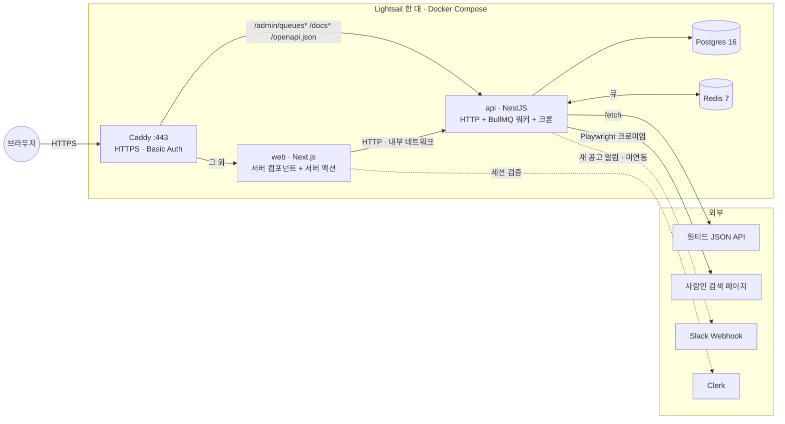
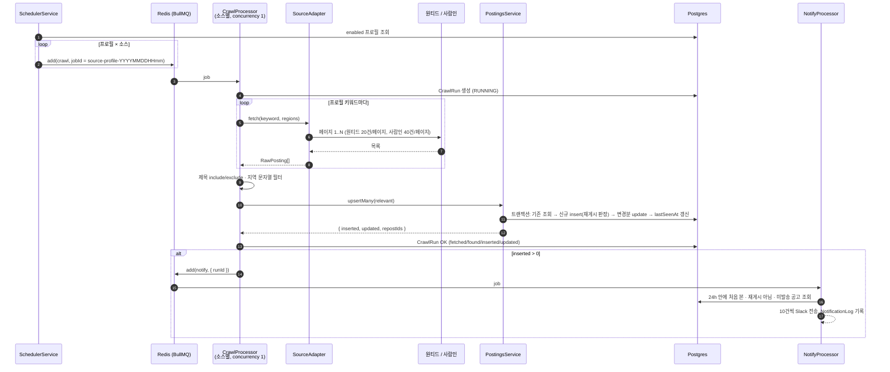
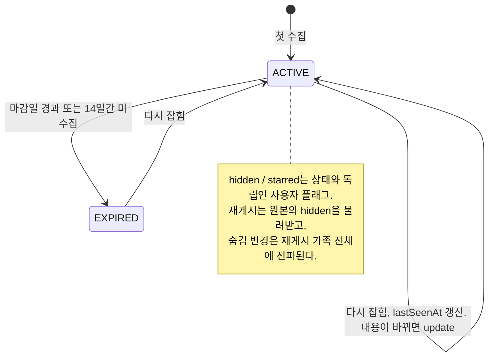
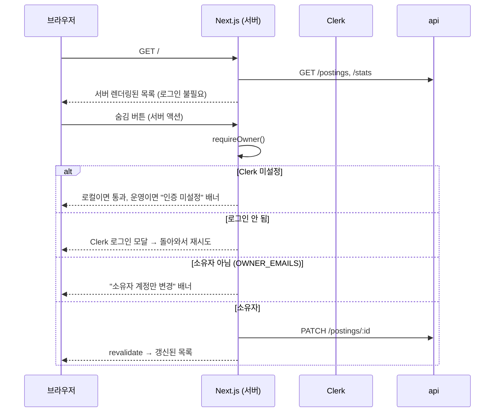
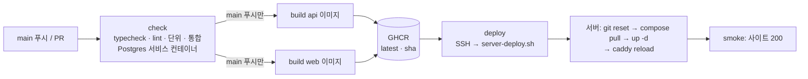

# trawler 설계 문서

원티드·사람인 채용 공고를 주기적으로 수집해 한 곳에서 보는 개인용 서비스다. 이 문서는 코드를 열기 전에 전체 그림과 "왜 이렇게 했는지"를 잡기 위한 것이고, 각 모듈의 세부 동작은 README와 소스 주석에 있다. 운영 인프라(Lightsail, 비용, 서버 .env)는 [deploy/README.md](../deploy/README.md)에 따로 둔다.

- [1. 한눈에 보기](#1-한눈에-보기)
- [2. 런타임 구성](#2-런타임-구성)
- [3. 수집 파이프라인](#3-수집-파이프라인)
- [4. 공고의 정체성과 생명주기](#4-공고의-정체성과-생명주기)
- [5. API 횡단 관심사](#5-api-횡단-관심사)
- [6. 대시보드와 권한](#6-대시보드와-권한)
- [7. 배포 파이프라인](#7-배포-파이프라인)
- [8. 테스트 전략](#8-테스트-전략)
- [9. 설계 결정 기록 (ADR)](#9-설계-결정-기록-adr)
- [10. 알려진 한계와 다음 단계](#10-알려진-한계와-다음-단계)

## 1. 한눈에 보기



구성은 세 층이다.

| 층 | 패키지 | 역할 |
|---|---|---|
| 계약 | `packages/shared` | zod 스키마와 타입. API 입력 검증, 응답 타입, OpenAPI 문서, 대시보드 타입이 전부 여기서 나온다. |
| 백엔드 | `apps/api` | NestJS 12. HTTP API, BullMQ 워커, 크론 스케줄러, Playwright 크롤러가 한 프로세스에 있고 `ROLE`로 나눌 수 있다. |
| 프론트 | `apps/web` | Next.js 16 App Router. 브라우저는 API에 직접 붙지 않고 서버 컴포넌트가 읽고 서버 액션이 쓴다. |

## 2. 런타임 구성

운영은 `docker-compose.prod.yml` 하나로 다섯 컨테이너를 띄운다. 외부에 열린 포트는 Caddy의 80/443뿐이다.

| 컨테이너 | 이미지 | 비고 |
|---|---|---|
| caddy | `caddy:2` | sslip.io 도메인에 Let's Encrypt 자동 발급. `/admin/queues*`만 Basic Auth, `/docs*`·`/openapi.json`은 공개로 api에 전달, 나머지는 web. |
| web | GHCR `trawler-web` | `API_URL=http://api:3000`. Clerk 공개 키는 빌드 시 인라인, 시크릿·소유자 이메일은 런타임 `.env`. |
| api | GHCR `trawler-api` | Playwright 공식 이미지 기반(크로미엄 포함). `ipc: host`(크로미엄 공유 메모리). 기동 시 `prisma migrate deploy`. healthcheck는 `/health`. |
| postgres | `postgres:16-alpine` | 볼륨 `pgdata`. |
| redis | `redis:7-alpine` | AOF 켜짐. BullMQ 잡 저장소. |

### 프로세스 역할 (`ROLE`)

`apps/api`는 한 바이너리를 역할만 바꿔 띄울 수 있게 돼 있다(`config/role.ts`, `queue/queue.module.ts`).

| ROLE | HTTP | 큐 producer | 큐 worker | 크론 |
|---|---|---|---|---|
| `all` (기본) | O | O | O | O |
| `api` | O | O | – | – |
| `worker` | O(사용 안 함) | O | O | O |

큐 등록과 Bull Board는 항상 올라가고, 워커 프로세서와 `SchedulerService`만 `runsWorkers()`일 때 providers에 추가된다. 운영은 아직 `all` 한 컨테이너다(10장 참고).

### 스케줄

| 크론 | 기본값 | 운영 | 하는 일 |
|---|---|---|---|
| `CRAWL_CRON` | 30분마다 | `0 8-22/2 * * *` (하루 8회) | 활성 프로필 × 소스마다 크롤 잡 enqueue |
| `MAINTENANCE_CRON` | 03:15 | 동일 | 만료 처리, 1시간 넘게 RUNNING인 실행을 FAILED로 정리 |

## 3. 수집 파이프라인



설계 포인트:

- **소스별 큐.** `crawl-wanted`, `crawl-saramin`, `notify` 세 큐. 사람인은 브라우저를 띄우므로 concurrency 1로 한 번에 한 브라우저만 돈다. `lockDuration` 5분으로 느린 크롤이 stalled 판정을 받지 않게 했다.
- **잡 ID로 중복 방지.** `{source}-{profileId}-{분}`이라 크론이 두 번 튀거나 "지금 수집"을 연타해도 같은 분 안에서는 잡 하나로 합쳐진다.
- **재시도와 최종 실패 알림.** 기본 3회, 지수 백오프 10초. 3회째도 실패하면 그것이 "사이트가 바뀌었거나 차단됐다"는 유일한 신호이므로 Slack 경고를 보낸다(`ALERT_MIN_INTERVAL_MIN`, 6시간에 한 번). 프로필이 삭제돼 `NotFoundException`이 나면 `UnrecoverableError`로 재시도 없이 끝낸다.
- **어댑터는 무상태.** `SourceAdapter { source, fetch(keyword, opts) }` 하나로 두 사이트를 추상화한다. 원티드는 SPA가 쓰는 JSON API를 그대로 호출하고, 사람인은 서버 렌더링 HTML을 Playwright로 열어 `.item_recruit`를 파싱한다(추출 함수는 페이지 컨텍스트에서 실행되는 순수 함수라 jsdom으로 단위 테스트한다). 페이지 사이에 1초 / 2~4초 랜덤 대기.
- **알림은 큐가 분리되어 있고 멱등.** `NotificationLog(postingId, channel, kind)`가 unique라 같은 공고가 두 번 가지 않고, 실패한 배치는 다음 잡에서 다시 시도한다.

## 4. 공고의 정체성과 생명주기

공고를 "같다"고 보는 기준이 둘이다(`postings/identity.ts`).

| 키 | 정의 | 용도 |
|---|---|---|
| `(source, externalId)` | 사이트가 준 ID | DB unique. upsert 기준. |
| `contentHash` | sha1(title, company, dueDate) | 같은 공고가 **수정**됐는지. 다르면 update, 같으면 `lastSeenAt`만 갱신. |
| `fingerprint` | md5(정규화한 company ‖ title) | 같은 자리가 **새 ID로 재등록**됐는지. 45일(`REPOST_WINDOW_DAYS`) 안에 같은 fingerprint가 있으면 `repostOfId`를 단다. |

정규화는 회사명에서 법인 접미사(주식회사, ㈜ 등)를, 제목에서 괄호 안 수식어와 채용 상투어("경력 3년 이상", "채용", "정규직" 등)를 떼고 한글·영숫자만 남긴다. 같은 규칙이 SQL 백필 마이그레이션에도 있어서 통합 테스트가 JS 함수와 SQL 결과를 같은 샘플로 대조한다.



삭제는 하지 않는다. 만료된 공고도 목록에서 "만료 포함"으로 볼 수 있고, 재수집되면 ACTIVE로 돌아온다. 재게시 공고는 저장은 되지만 알림 대상에서 빠지고 목록에 "재게시" 표시가 붙는다.

## 5. API 횡단 관심사

요청 하나가 거치는 순서와 각 단계의 책임이다.

```
요청 → pino-http (req.id 생성/승계, 접근 로그)
     → requestId 미들웨어 (res.locals, x-request-id 응답 헤더)
     → ThrottlerGuard (기본 120/분, 수집·유지보수 POST는 10/분)
     → ZodValidationPipe (shared 스키마로 query/body 검증 → 400 + issues[])
     → 컨트롤러 / 서비스
     → AllExceptionsFilter (모든 예외를 ErrorBody 한 형식으로)
```

- **계약은 zod 한 벌.** `packages/shared`의 스키마가 입력 검증(`ZodValidationPipe`), 응답 타입(대시보드 `api.ts`), OpenAPI 문서(`docs/openapi.ts`, zod-openapi) 세 곳에 쓰인다. 문서와 코드가 어긋날 수 없고, `openapi.spec.ts`가 문서의 경로 목록과 실제 라우트를 대조한다.
- **오류 형식 하나.** `{ statusCode, error, message, issues?, requestId, path, timestamp }`. Prisma P2002는 409, P2025는 404로 번역하고, 그 외 예상 못 한 오류는 500에 일반 메시지만 내보내고 상세는 서버 로그에 남긴다.
- **요청 ID로 로그 추적.** pino-http가 AsyncLocalStorage로 요청 범위 로거를 두기 때문에 기존 `new Logger(Name)` 호출을 바꾸지 않고도 요청 중 찍힌 모든 줄에 `req.id`가 붙는다. 오류 응답의 `requestId`와 같은 값이라 `docker compose logs api | grep <id>`로 그 요청의 전체 로그가 나온다. 잡 로그는 메시지 문자열 대신 `{ jobId, runId, source, inserted, durationMs }` 필드로 남긴다.
- **헬스.** `/health`는 Postgres(`SELECT 1`)와 Redis(큐 카운트)를 각각 1.5초 타임아웃으로 확인해 하나라도 죽으면 503 `degraded`를 돌려준다. compose healthcheck가 이것을 본다.

## 6. 대시보드와 권한



- **조회는 공개, 변경만 보호.** 로그인을 첫 화면에서 요구하지 않는다. 숨김·별표·프로필 변경·지금 수집 버튼을 누르는 순간에만 Clerk 모달이 뜬다. 버튼 자체는 로그인 여부에 따라 실제 폼 또는 로그인 트리거로 렌더링된다.
- **게이트는 서버 액션 안에.** 미들웨어(`proxy.ts`)는 세션을 읽기만 하고 아무 경로도 막지 않는다. 미들웨어 단독 보호는 우회된 전례(CVE-2025-29927)가 있어서, 변경하는 모든 액션 첫 줄에서 `requireOwner()`를 부른다. Clerk 쪽 가입 제한과 코드 쪽 `OWNER_EMAILS` 검사가 이중 안전망이다.
- **브라우저는 API를 모른다.** API는 Caddy 뒤 내부 네트워크에만 있고(문서·Bull Board 경로 제외), 데이터는 서버 컴포넌트가 `API_URL`로 읽어온다. CORS, 토큰 전달, 클라이언트 fetch 상태 관리가 전부 필요 없다.
- **URL이 필터 상태.** 소스·검색어·신규·숨김·별표·만료 필터는 nuqs로 쿼리스트링에 산다. 선택은 즉시, 검색어는 debounce로 반영되고, 링크를 공유하면 같은 화면이 나온다.

## 7. 배포 파이프라인



- 서버는 빌드하지 않고 이미지만 받는다. Dockerfile이 의존성 레이어를 먼저 만들어서 잠금 파일이 그대로면 서버가 받는 건 소스 레이어뿐이다.
- 배포 키는 `authorized_keys`에 `command="deploy/server-deploy.sh"`로 묶여 있어 그 스크립트 말고는 실행할 수 없다. GHCR 토큰은 워크플로마다 발급되는 `GITHUB_TOKEN`을 stdin으로 넘겨 즉석에서 로그인·로그아웃하고 서버에 남기지 않는다.
- 롤백은 `IMAGE_TAG=<sha> docker compose up -d`. 마이그레이션은 api 컨테이너 기동 시 `prisma migrate deploy`로 전진만 한다.
- 문서만 바뀐 푸시(`*.md`, `docs/`)는 워크플로를 건너뛴다.

## 8. 테스트 전략

| 종류 | 위치 | 대상 | 실행 |
|---|---|---|---|
| 단위 (api) | `*.spec.ts` | 정체성 규칙, 제목 필터, 사람인 HTML 추출(jsdom), 큐 상수, 로거 설정, 예외 필터, 헬스(스텁), 실행 통계 집계, OpenAPI 경로 대조 | `pnpm test` |
| 단위 (shared, web) | `*.spec.ts` | zod 스키마, 날짜 포맷, 소유자 판정 | `pnpm test` |
| 통합 (api) | `*.int.spec.ts` | `upsertMany` 트랜잭션·재게시·숨김 전파, 만료, 알림 멱등성, fingerprint SQL 백필 = JS 함수 | `pnpm test:int` (`trawler_test` DB를 만들고 마이그레이션) |

원칙은 세 가지다. 판정 로직(정체성, 필터, 집계, 로거 옵션)은 Prisma·Nest에서 떼어낸 순수 함수로 두고 단위 테스트한다. DB가 끼는 규칙은 실제 Postgres로 돌린다(모킹하면 트랜잭션·unique 제약을 못 본다). 외부 사이트는 절대 치지 않고 저장해 둔 HTML 픽스처로만 검증한다.

## 9. 설계 결정 기록 (ADR)

### ADR-1. 모노레포 + zod 스키마를 단일 계약으로

- **맥락.** API와 대시보드가 같은 타입을 쓰는데, 둘이 어긋나면 런타임에만 드러난다.
- **결정.** pnpm 워크스페이스로 `packages/shared`를 두고 zod 스키마를 유일한 원천으로 삼는다. 검증·타입·OpenAPI 문서가 전부 여기서 파생된다.
- **결과.** 스키마를 바꾸면 API 검증, 대시보드 타입, 문서가 같이 바뀌고 typecheck가 어긋남을 잡는다. 대가는 shared를 먼저 빌드해야 하는 순서 의존(CI와 Dockerfile에 반영).

### ADR-2. 크론 인라인 실행 대신 BullMQ 큐

- **맥락.** 처음엔 크론 안에서 바로 크롤해도 됐다. 하지만 크롤은 수십 초에서 분 단위이고 실패하며, "지금 수집" 버튼과 크론이 겹친다.
- **결정.** 크론은 enqueue만 하고 소스별 워커가 처리한다. 재시도·백오프·중복 합치기·관측(Bull Board)을 큐에 맡긴다.
- **결과.** HTTP와 수집이 분리돼 `ROLE`로 프로세스를 나눌 길이 열렸고, 사람인 브라우저를 concurrency 1로 직렬화할 수 있다. Redis가 추가 인프라로 들어왔고 `/health`도 Redis를 봐야 한다.

### ADR-3. 재게시 판정은 정규화 fingerprint, 알림만 억제

- **맥락.** 같은 자리가 며칠마다 새 ID로 다시 올라와 알림이 반복됐다. 사이트 ID로는 잡을 수 없다.
- **결정.** 회사·제목을 정규화한 fingerprint가 45일 안에 있으면 재게시로 표시한다. 저장은 하되 알림에서 빼고, 원본의 숨김 상태를 물려받는다. 정규화 규칙을 느슨하게 바꿀 때는 SQL 백필을 함께 넣고 JS와 SQL을 같은 샘플로 대조하는 테스트를 둔다.
- **결과.** 반복 알림이 사라졌고 "숨김"이 재게시에도 이어진다. 제목이 크게 바뀌면 놓치고(미탐), 같은 회사의 다른 포지션 제목이 상투어만 다르면 잘못 묶일 수 있다(오탐). 둘 다 치명적이지 않아 느슨한 쪽을 택했다.

### ADR-4. 원티드는 JSON API, 사람인은 Playwright

- **맥락.** 두 사이트의 렌더링 방식이 다르다. 원티드는 SPA가 공개 JSON 엔드포인트를 호출하고, 사람인은 서버 렌더링 HTML이다.
- **결정.** 소스마다 가장 가벼운 수단을 쓴다. 원티드는 `fetch`, 사람인만 크로미엄. 추출 로직은 페이지 컨텍스트에서 도는 순수 함수로 분리해 jsdom으로 테스트한다. 브라우저는 크롤마다 열고 닫되 프로필 디렉터리는 유지해 쿠키를 남긴다.
- **결과.** 원티드는 빠르고 가볍다. 사람인 때문에 api 이미지가 Playwright 베이스(크로미엄 포함)여야 하고 서버에 스왑이 필요하다. 레이아웃 변경은 스크린샷(`storage/debug/`)과 3회 실패 알림으로 감지한다.

### ADR-5. 로그인은 변경 버튼을 누를 때만, 게이트는 서버 액션 안에

- **맥락.** 공개 포트폴리오 사이트라 누구나 봐야 하지만, 숨김·프로필 변경·수집 트리거는 소유자만 해야 한다. 자체 계정 시스템은 과하다.
- **결정.** Clerk를 쓰되 첫 화면에서 로그인을 요구하지 않는다. 변경 액션의 첫 줄에서 `requireOwner()`가 로그인·소유자 여부를 확인하고, 미들웨어는 세션만 읽는다. Clerk 키가 없으면 로컬은 열린 모드, 운영은 변경 거부.
- **결과.** 방문자는 바로 목록을 보고 소유자는 버튼을 누를 때 한 번 로그인한다. `*.sslip.io`에는 Clerk 프로덕션 인스턴스를 붙일 수 없어 개발 인스턴스 키를 쓰며, 모달에 "Development mode"가 표시되는 것을 감수했다.

### ADR-6. Lightsail 한 대에 전부

[deploy/README.md의 "왜 Lightsail + 한 대인가"](../deploy/README.md#왜-lightsail--한-대인가) 참고. 요지: 상시 프로세스(크론·워커·크로미엄)라 서버리스가 맞지 않고, 개인용이라 관리형 DB·캐시는 비용만 늘며, 국내 사이트는 서울 IP가 안전하다.

## 10. 알려진 한계와 다음 단계

- **단일 인스턴스.** 서버 한 대가 죽으면 전부 멈춘다. 개인용이라 감수하고, 컨테이너 `restart: unless-stopped`와 재부팅 시 Docker 자동 기동으로 복구한다.
- **`ROLE` 분리는 코드만 있다.** 운영은 `all` 한 컨테이너. api/worker 두 컨테이너로 나눠 실증하는 것이 다음 항목이다(2GB 메모리에서 크로미엄 둘이 가능한지 먼저 확인).
- **Slack 알림은 미연동.** 코드·테스트는 있지만 운영 서버에 웹훅을 넣지 않았다.
- **목록 페이지만 수집.** 상세 페이지(기술 스택, 연봉)는 긁지 않는다. 요청 수가 몇 배로 늘어 차단 위험이 커지기 때문에 보류.
- **사람인 픽스처가 손으로 만든 HTML.** 실제 응답을 익명화해 교체하면 레이아웃 변경 회귀를 더 잘 잡는다.
